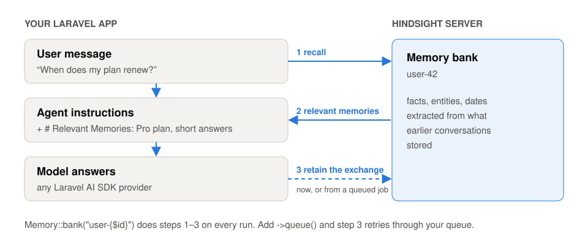

# Hindsight for PHP and Laravel

[](https://github.com/skybleak333/hindsight-php/actions/workflows/tests.yml)
[](composer.json)
[](LICENSE)

A PHP client for [Hindsight](https://github.com/vectorize-io/hindsight), the open-source memory server for AI agents, and long-term memory for [Laravel AI SDK](https://github.com/laravel/ai) agents and [Laravel MCP](https://github.com/laravel/mcp) servers.

A Laravel AI agent forgets everything when the conversation ends. With one middleware it remembers: before it answers, it recalls what it knows about the user; after it answers, it stores the exchange.

```php
use Fedoseev\Hindsight\Laravel\Ai\Memory;

class SupportAgent implements Agent, HasMiddleware
{
    use Promptable;

    public function __construct(private User $user) {}

    public function instructions(): string
    {
        return 'You are a friendly support agent.';
    }

    public function middleware(): array
    {
        return [Memory::bank("user-{$this->user->id}")];
    }
}
```

Monday: *"I'm on the Pro plan and I prefer short answers."* Friday, in a new conversation: *"When does my plan renew?"* The agent already knows the plan and answers briefly.

<picture>
  <source media="(prefers-color-scheme: dark)" srcset="docs/how-it-works-dark.svg">
  
</picture>

- **Memory that waits out an outage.** With `->queue()`, each exchange is stored by a queued job that retries while the Hindsight API is unavailable. Every attempt sends the same operation ID, so a retry never stores a memory twice.
- **Tests without a server.** `Hindsight::fake()` replaces the client with an in-memory server and gives you `assertRetained()` and `assertRecalled()`. CI compares its tag filters, document handling and rejected requests with real Hindsight servers.

**Why not `RemembersConversations`?** The Laravel AI SDK's own conversation memory replays the latest messages of one conversation, up to 100 by default (`maxConversationMessages()` in laravel/ai 1.3). A new conversation starts empty, and a long one loses its beginning. Hindsight keeps facts across conversations and recalls only the ones relevant to the current message. The two work together: `RemembersConversations` for the thread, `Memory` for what the agent should know about the user.

This is a community package. It is not affiliated with Vectorize, the company behind Hindsight.

## Contents

- [Installation](#installation)
- [Run a Hindsight server](#run-a-hindsight-server)
- [The client](#the-client)
- [Laravel](#laravel)
- [Memory for Laravel AI SDK agents](#memory-for-laravel-ai-sdk-agents)
- [Memory tools for MCP servers](#memory-tools-for-mcp-servers)
- [Queued retains](#queued-retains)
- [Errors](#errors)
- [Testing your application](#testing-your-application)
- [How this package is tested](#how-this-package-is-tested)
- [Compatibility](#compatibility)

## Installation

```bash
composer require fedoseev/hindsight-php
```

Until the package is listed on Packagist, tell Composer where to find it first:

```bash
composer config repositories.hindsight-php vcs https://github.com/skybleak333/hindsight-php
composer require fedoseev/hindsight-php:^0.3
```

The client needs PHP 8.2+ and works in any PHP project. The Laravel integration is discovered automatically. The agent memory needs [`laravel/ai`](https://github.com/laravel/ai) 1.x and PHP 8.3+. The MCP tools need [`laravel/mcp`](https://github.com/laravel/mcp) 1.x.

## Run a Hindsight server

The quickest way is Docker. It starts the API on port 8888 and the web UI on port 9999:

```bash
docker run -it --pull always --name hindsight -p 8888:8888 -p 9999:9999 \
  -e HINDSIGHT_API_LLM_API_KEY=$OPENAI_API_KEY \
  -v hindsight-data:/home/hindsight/.pg0 \
  ghcr.io/vectorize-io/hindsight:latest
```

Hindsight uses an LLM to turn what you store into facts. It supports OpenAI, Anthropic, Gemini, Groq, Ollama and many other providers. See the [installation guide](https://hindsight.vectorize.io/developer/installation) for all options, or use [Hindsight Cloud](https://vectorize.io/pricing) at `https://api.hindsight.vectorize.io`.

## The client

```php
use Fedoseev\Hindsight\Hindsight;

$hindsight = new Hindsight('http://localhost:8888', apiKey: getenv('HINDSIGHT_API_KEY') ?: null);

// Store a memory. The server extracts facts, entities and dates from it.
$hindsight->retain('my-bank', 'Alice works at Google as a software engineer.');

// Find what is relevant to a question.
$memories = $hindsight->recall('my-bank', 'What does Alice do?');

foreach ($memories as $memory) {
    echo $memory->text;   // "Alice works at Google as a software engineer"
}

// Let the server reason over everything it remembers.
echo $hindsight->reflect('my-bank', 'Tell me about Alice');
```

You do not need to create a bank first: retain and other writes create a missing bank with default settings. Reads of a bank nobody has written to answer `404`, and the agent middleware and tools treat that as "no memories yet". Method names and arguments follow the official [Python and TypeScript clients](https://hindsight.vectorize.io/sdks/python), so the Hindsight documentation applies directly.

### Retain

```php
use Fedoseev\Hindsight\Hindsight;

$hindsight->retain(
    'support',
    'The customer asked to move the delivery to Friday.',
    timestamp: new DateTimeImmutable('2026-10-28 14:00'),
    context: 'support chat',
    documentId: 'ticket-4521',
    tags: ['user:42'],
    metadata: ['channel' => 'chat'],
);

// Many items in one request. Keys can be camelCase or the API's snake_case.
$hindsight->retainBatch('support', [
    ['content' => 'Prefers email over phone.', 'tags' => ['user:42']],
    ['content' => 'Lives in Rotterdam.', 'tags' => ['user:42'], 'documentId' => 'profile-42'],
]);
```

Retain calls the server's LLM, so it can take a few seconds. Pass `async: true` to return at once and let the server work in the background:

```php
$response = $hindsight->retain('support', $transcript, async: true);

// Later, or in a queued job:
$operation = $hindsight->waitForOperation('support', $response->operationId, timeout: 60);
```

`waitForOperation()` throws `OperationFailedException` if the operation fails and `TimeoutException` if it is still running after the timeout. When an async batch mixes items with different retain strategies, the server splits it into several operations: then `operationId` is `null` and the IDs are in `operationIds`.

### Recall

```php
use Fedoseev\Hindsight\Budget;
use Fedoseev\Hindsight\TagsMatch;

$memories = $hindsight->recall(
    'support',
    'How does this customer want to be contacted?',
    budget: Budget::High,          // how hard to search: Low, Mid (default) or High
    maxTokens: 2048,               // upper bound for the size of the results
    types: ['world', 'experience'],
    tags: ['user:42'],
    tagsMatch: TagsMatch::AnyStrict, // only memories tagged user:42
);

$memories->texts();     // ['Prefers email over phone', ...]
$memories->toPrompt();  // "- Prefers email over phone\n- Lives in Rotterdam" for an LLM prompt
$memories->isEmpty();

$first = $memories->results[0];
$first->id; $first->text; $first->type; $first->occurredStart; $first->documentId; $first->tags;
```

Any other recall option goes into `options`, with the API's field names: `options: ['include' => ['chunks' => ['max_tokens' => 2000]]]`.

### Reflect

```php
$answer = $hindsight->reflect('support', 'Summarise this customer', tags: ['user:42'], includeFacts: true);

$answer->text;     // Markdown
$answer->basedOn;  // the memories the answer used

// Structured output
$answer = $hindsight->reflect('support', 'Where does the customer live?', responseSchema: [
    'type' => 'object',
    'properties' => ['city' => ['type' => 'string']],
    'required' => ['city'],
]);

$answer->structuredOutput; // ['city' => 'Rotterdam']
```

### Everything else

| Area | Methods |
|---|---|
| Banks | `listBanks`, `createBank`, `updateBank`, `getBankStats`, `deleteBank`, `getBankConfig`, `updateBankConfig`, `resetBankConfig` |
| Bank aliases | `listBankAliases`, `addBankAlias`, `setPrimaryBankAlias`, `removeBankAlias` |
| Memories | `listMemories`, `getMemory`, `clearMemories` |
| Documents | `listDocuments`, `getDocument`, `deleteDocument` |
| Directives | `createDirective`, `listDirectives`, `getDirective`, `updateDirective`, `deleteDirective` |
| Mental models | `createMentalModel`, `listMentalModels`, `getMentalModel`, `updateMentalModel`, `deleteMentalModel`, `refreshMentalModel` |
| Operations | `getOperation`, `listOperations`, `cancelOperation`, `retryOperation`, `waitForOperation` |
| Server | `health`, `version` |

Bank settings such as the reflect mission and disposition live in the bank configuration since Hindsight 1.1 (the old profile endpoints answer `410 Gone`):

```php
$hindsight->createBank('support', name: 'Support', reflectMission: 'Help customers of an online shop.');
$hindsight->updateBankConfig('support', ['disposition_empathy' => 5]);
```

An alias is another id that reaches the same bank, so a bank can be renamed while clients move to the new id one by one. A failed operation, for example a retain that hit the LLM provider's rate limit, can be queued again:

```php
$hindsight->addBankAlias('support', 'helpdesk');            // requests to "helpdesk" now reach "support"
$hindsight->retryOperation('support', $failed->id);
```

For any endpoint without its own method, use `request()`. It returns the decoded JSON:

```php
$tags = $hindsight->request('GET', '/v1/default/banks/support/tags', query: ['limit' => 50]);
```

The client accepts any [PSR-18](https://www.php-fig.org/psr/psr-18/) HTTP client. Without one it uses Guzzle with a 120-second timeout, because synchronous retain and reflect wait for the server's LLM. For calls on a user's request path, take a copy with a shorter timeout:

```php
$hindsight = new Hindsight('https://api.hindsight.vectorize.io', apiKey: $key, httpClient: $myPsr18Client);

$fast = $hindsight->withTimeout(5); // a client you passed in keeps its own timeout
```

### Typos in options do not go unnoticed

Hindsight accepts parameters it does not know, ignores them and answers `200`. A misspelled option such as `max_token` therefore changes the result without any error. The server does name the ignored parameters in an `X-Ignored-Params` response header, and this client turns that header into a warning for any [PSR-3](https://www.php-fig.org/psr/psr-3/) logger:

```php
$hindsight = new Hindsight('http://localhost:8888', logger: $logger);

$hindsight->recall('support', 'plan', options: ['max_token' => 500]);
// warning: Hindsight ignored unknown parameters: max_token (POST /v1/default/banks/support/memories/recall)
```

In Laravel the warning goes to your default log channel without any setup.

## Laravel

Add the server to `.env`:

```dotenv
HINDSIGHT_URL=http://localhost:8888
HINDSIGHT_API_KEY=
```

Check the connection:

```bash
php artisan hindsight:status
php artisan hindsight:status --bank=support
```

The client is a singleton in the container. Inject `Fedoseev\Hindsight\Hindsight` or use the facade:

```php
use Fedoseev\Hindsight\Laravel\Facades\Hindsight;

Hindsight::retain("user-{$user->id}", 'Upgraded to the Pro plan.', tags: ['billing']);
```

To change the timeout or add headers, publish the config:

```bash
php artisan vendor:publish --tag=hindsight-config
```

To add retries, a proxy or logging, bind your own PSR-18 client as `hindsight.http` before the client is first used.

### Laravel Boost

The package ships a [Laravel Boost](https://github.com/laravel/boost) guideline and an agent skill, `hindsight-php-agent-memory`, so a coding agent in your project knows how to add memory to an agent, queue retains and test with `Hindsight::fake()`. Run `php artisan boost:install` and pick `fedoseev/hindsight-php` from the third-party list, or add it to `packages` in `boost.json`. Boost then adds the guideline to your agent's guideline file (for example `CLAUDE.md`) and copies the skill into the agent's skills directory.

## Memory for Laravel AI SDK agents

### The middleware

`Memory` is an [agent middleware](https://laravel.com/docs/ai-sdk). On every run it does two things:

1. **Before the first step**, it recalls memories relevant to the user's message and adds them to the agent's instructions:

   ```
   You are a friendly support agent.

   # Relevant Memories
   The following information from long-term memory may be relevant:

   - Alice is on the Pro plan (2026-09-01)
   - Alice prefers short answers
   ```

   The memories stay in the instructions for every step of the run, including the steps after tool calls.

2. **After the step that ends the run**, it retains the exchange as a short transcript: a `USER:` line with the message and an `ASSISTANT:` line with the answer. It uses the same rule as the Laravel AI loop to decide that a run has ended. A step that asks for tools is never stored, so a run that pauses for tool approval is stored once, when it finishes. Streamed answers are stored once the stream has been read. For agents with structured output, the `ASSISTANT:` line is the JSON the model returned.

```php
public function middleware(): array
{
    return [
        Memory::bank('support')
            ->tags(["user:{$this->user->id}"])           // only this user's memories, and tag what is stored
            ->recallBudget(Budget::Mid, maxTokens: 2048) // default: Low, 1024 tokens
            ->document("conversation-{$this->conversationId}") // append each exchange to one document
            ->context('Support chat on example.com'),     // helps the server extract better facts
    ];
}
```

| Method | What it does |
|---|---|
| `recallBudget($budget, $maxTokens, $types)` | How hard recall searches and how much it may add. Default `Budget::Low` and 1,024 tokens, to keep latency down. |
| `tags($tags, $match)` | Recall only memories with these tags and tag the stored exchanges. Untagged memories are left out by default (`TagsMatch::AnyStrict`), so a bank shared by many users does not mix them up. Pass `TagsMatch::Any` to include untagged memories, such as knowledge every user should get. |
| `document($id)` | Append every exchange to one document (`update_mode: append`) instead of storing each separately. |
| `context($text)` | Describe the source of the conversations. |
| `withoutRecall()` / `withoutRetain()` | Use only one half. |
| `retainSynchronously()` | Wait for fact extraction. By default retains are async, so the user does not wait. |
| `queue($connection, $queue)` | Store each exchange from a queue worker, with retries. See [Queued retains](#queued-retains). |
| `timeout($seconds)` | How long to wait for Hindsight. Default 10 seconds for recall and async retains; a synchronous retain uses the client's timeout. |
| `throwOnError()` | Fail the run when Hindsight fails. See below. |
| `using($client)` | Use a specific client instead of the container's. |

Memory is best effort by default. If Hindsight is down, too slow or answers with an error, the middleware reports the exception through Laravel's exception handler and the agent answers without memory. A hung server costs at most the 10-second timeout, not the client's 120 seconds. If you bound your own HTTP client as `hindsight.http`, its own timeout applies instead, so give it one. Call `throwOnError()` if a run without memory is worse than no run.

List `Memory` first in `middleware()`. Then it sees each step as the model finally answers it, even when another middleware asks the model again.

### The tools

Sometimes the agent should decide itself when to look something up or what is worth keeping. Give it the tools:

```php
use Fedoseev\Hindsight\Laravel\Ai\Tools\Recall;
use Fedoseev\Hindsight\Laravel\Ai\Tools\Reflect;
use Fedoseev\Hindsight\Laravel\Ai\Tools\Retain;

public function tools(): iterable
{
    $bank = "user-{$this->user->id}";

    return [
        Recall::bank($bank),   // recall_memory: search memory
        Retain::bank($bank),   // retain_memory: store a fact the agent finds important
        Reflect::bank($bank),  // reflect_memory: reason over everything in memory
    ];
}
```

Each tool takes `tags()` (strict by default, like the middleware), `timeout()`, `using()` and `named()` (to rename it, for example when an agent has tools for two banks). `Recall` and `Reflect` take `budget()`. The default timeouts are 15 seconds for `Recall` and `Retain` and 60 for `Reflect`, which runs the server's LLM. When Hindsight fails, a tool returns the error to the model instead of ending the run, so the agent can still answer.

The middleware and the tools work together. A common setup is the middleware for automatic memory plus `Retain` for facts the agent should keep on purpose.

## Memory tools for MCP servers

With [Laravel MCP](https://github.com/laravel/mcp), your app can be an MCP server for clients like Claude Desktop or Cursor. The same three tools exist for it, so the client gets long-term memory stored in your Hindsight:

```php
use Fedoseev\Hindsight\Laravel\Mcp\Tools\Recall;
use Fedoseev\Hindsight\Laravel\Mcp\Tools\Reflect;
use Fedoseev\Hindsight\Laravel\Mcp\Tools\Retain;
use Laravel\Mcp\Request;
use Laravel\Mcp\Server;

class AssistantServer extends Server
{
    protected function boot(): void
    {
        // A bank for each user, picked on every call.
        $bank = fn (Request $request): string => 'user-'.$request->user()->getAuthIdentifier();

        $this->tools = [
            Recall::bank($bank),
            Retain::bank($bank),
            Reflect::bank($bank),
        ];
    }
}
```

```php
// routes/ai.php
use Laravel\Mcp\Facades\Mcp;

Mcp::web('/mcp/assistant', AssistantServer::class)->middleware('auth:sanctum');
```

`bank()` takes a bank ID or a closure that gets the MCP request. Everything else works as with the agent tools: `tags()`, `timeout()`, `using()`, `named()`, and `budget()` on `Recall` and `Reflect`. The tools validate their arguments, and tell the client that `recall_memory` and `reflect_memory` only read and that `retain_memory` is not destructive: it only adds memories.

When Hindsight fails, the tool returns an error result and reports the exception. The client sees `Memory is unavailable right now.` The full message is shown only with `APP_DEBUG=true`, because the answer leaves your app. laravel/mcp does the same for other exceptions thrown by tools.

## Queued retains

By default the middleware stores each exchange during the run, and when the Hindsight API is unavailable that exchange is lost: the error is reported and the agent goes on. Add `queue()` and the exchange is stored by a queued job instead:

```php
public function middleware(): array
{
    return [Memory::bank("user-{$this->user->id}")->queue()];
}
```

The job is `Fedoseev\Hindsight\Laravel\Jobs\RetainMemory`. You can dispatch it yourself, for example from an event listener:

```php
use Fedoseev\Hindsight\Laravel\Jobs\RetainMemory;

RetainMemory::dispatch("user-{$user->id}", 'Upgraded to the Pro plan.', tags: ['billing']);
```

What the job does:

- **Retries while the Hindsight API is unavailable.** A refused connection, a timeout, `408`, `429` or a `5xx` answer sends the job back to the queue: six attempts, 10 seconds, 1, 5, 15 and 15 minutes apart, so a memory gets through an outage of about half an hour. Attempts before the last go back with a warning in the log; only a failure on the last attempt is reported, so an outage does not send six exceptions per memory to your error tracker.
- **Never stores a memory twice.** The job gets an operation ID when it is dispatched and sends it with every attempt. Hindsight treats an async retain with an operation ID it has already seen as the same operation, so a retry after a lost answer adds nothing. That includes two attempts at the same moment: [Hindsight's own tests](https://github.com/vectorize-io/hindsight/blob/v1.2.0/hindsight-api-slim/tests/test_async_retain_operation_id.py) cover simultaneous submissions with one ID. The ID comes from `random_bytes()`, not `Str::uuid()`, so `Str::freezeUuids()` in your tests does not give every job the same one.
- **Keeps the time of the conversation.** The job sends the time it was dispatched as the memory's timestamp, so an exchange that waited in the queue during an outage is not dated by the moment a worker got to it.
- **Fails at once when a retry cannot help.** A wrong API key (`401`/`403`), a rejected request (other `4xx`) or a malformed `HINDSIGHT_URL` fails the job without retries and reports the exception, so it reaches your error tracker and not only the `failed_jobs` table.

The job is done once Hindsight has accepted the retain. Fact extraction then runs on the server, and if it fails there, for example because the server's LLM provider is down, the server retries a few times and marks the operation failed. The job cannot see that. Find such operations with `listOperations($bank, status: 'failed')` and queue them again with `retryOperation()`.

Set the connection, queue and retry policy in `config/hindsight.php`, or pass the connection and queue to `queue()`:

```dotenv
HINDSIGHT_QUEUE_CONNECTION=redis
HINDSIGHT_QUEUE=memory
HINDSIGHT_QUEUE_TRIES=6
HINDSIGHT_QUEUE_ENCRYPT=true   # the job carries the conversation; encrypt it in the queue with APP_KEY
```

```php
Memory::bank('support')->queue('redis', 'memory');
```

Some combinations behave differently:

- Queued retains are always async on the server, so `queue()` and `retainSynchronously()` cannot be combined.
- The worker gets the client from the container, so `queue()` cannot be combined with `using()`. Bind the client you need as `Fedoseev\Hindsight\Hindsight` instead.
- On the `sync` queue driver there are no retries: the job runs once during the run, and its errors are reported, or thrown with `throwOnError()`, as without `queue()`. The `deferred` and `background` drivers are built on `sync`: they also run the job once, after the response, where `throwOnError()` has no effect.
- With `document()`, exchanges of one conversation can be appended out of order when an attempt is retried or several workers run. Each exchange is sent with the time it was dispatched.

## Errors

Every exception implements `Fedoseev\Hindsight\Exceptions\HindsightException`.

| Exception | When |
|---|---|
| `ConfigurationException` | The URL is not an http(s) URL. Thrown when the client is created. |
| `ConnectionException` | The server could not be reached or did not answer in time. |
| `AuthenticationException` | 401 or 403: the API key is missing or wrong. |
| `NotFoundException` | 404: the bank, document or other resource does not exist. |
| `ValidationException` | 422: the server rejected the request. `errors()` lists the fields. |
| `ApiException` | Any other error status. Has `statusCode` and `body`. The three above extend it. |
| `UnexpectedResponseException` | A success status with a body that is not JSON, for example when the URL points at the web UI. |
| `OperationFailedException`, `TimeoutException` | From `waitForOperation()`. |

The message always contains the server's explanation:

```
Hindsight API error 422: body.items.0.content: Field required
```

## Testing your application

`Hindsight::fake()` replaces the client with an in-memory server. Seed what recall should find, run your code, then assert what was stored and searched:

```php
use Fedoseev\Hindsight\Laravel\Facades\Hindsight;

public function test_the_agent_uses_what_it_remembers(): void
{
    Hindsight::fake([
        'user-1' => ['Alice is on the Pro plan'],
    ]);
    SupportAgent::fake(['Your Pro plan renews on 1 December.']);

    (new SupportAgent($alice))->prompt('When does my plan renew?');

    Hindsight::assertRecalled('user-1', fn (string $query) => $query === 'When does my plan renew?');
    Hindsight::assertRetained('user-1', fn (string $content) => str_contains($content, 'renews on 1 December'));
}
```

The middleware, the tools and the `RetainMemory` job get the client from the container, so they all use the fake. Outside Laravel, create `new HindsightFake([...])` from `Fedoseev\Hindsight\Testing` and pass it wherever you pass the client.

| Method | What it does |
|---|---|
| `assertRetained($bank, $callback)` | A memory was stored in the bank. The callback gets the content and the item with the API's keys (`tags`, `document_id`, …) and returns whether it is the one; any truthy value counts. Pass an integer instead to assert how many. |
| `assertNotRetained($bank, $callback)`, `assertNothingRetained()` | The opposite. |
| `assertRecalled($bank, $callback)`, `assertNotRecalled($bank)` | The bank was searched. The callback gets the query and the request. |
| `assertReflected($bank, $callback)` | Reflect was called on the bank. |
| `retained($bank)`, `recalls($bank)` | What was stored and searched, to inspect it yourself. |
| `remember($bank, ...$memories)` | Seed more memories. A memory is its text, or an array such as `['text' => '…', 'tags' => ['user:1'], 'type' => 'experience']`. |
| `reflectUsing($answer)` | What reflect answers: a string, or a closure that gets the query and the bank. |
| `unavailable($times, $status)`, `available()` | Make requests fail as if Hindsight were down: a refused connection, or `$status` such as `503`. Without `$times`, until `available()`. |
| `respondTo($method, $path, $response)` | Answer an endpoint the fake does not simulate. `*` matches one path segment. |

The fake follows the server where a test depends on it:

- A bank nobody wrote to answers `404` with the server's message, so you test the first conversation of a new user as it will happen.
- Tag filters (`any`, `all`, `any_strict`, `all_strict`, `exact`) select the same memories as on the server.
- A retain with a `document_id` replaces that document unless it appends.
- An async retain repeated with the same operation ID stores nothing new, and an operation ID used in another bank answers `409`.
- These retains are rejected with the server's status: `422` for an operation ID that is not a UUID, a timestamp that is not ISO 8601 (or `unset`), a tag or metadata value that is not a string, or an unknown `update_mode`, and `400` for an append without a `document_id`. Other invalid fields are not checked.

It is simpler than the server on purpose: a stored item becomes one memory with its text as sent (no fact extraction), recall returns every memory that passes the filters in the order they were stored (no ranking, no token budget), and async work is finished at once. An endpoint the fake does not simulate throws a `LogicException` instead of answering something made up.

To check a single HTTP call yourself, bind any PSR-18 client as `hindsight.http` before the client is first used, for example Guzzle's `MockHandler`.

## How this package is tested

- **Every request in the unit tests is checked against Hindsight's own [OpenAPI document](tests/Fixtures/openapi-1.1.0.json)**, downloaded from the `v1.1.0` tag. The check is stricter than the server: Hindsight answers `200` for unknown fields, so a misspelled field name in the client would never fail a request. The tests reject it. Response fixtures are checked against the same document.
- **CI starts real Hindsight 1.1.0, 1.2.0 and 1.2.1 servers** (`hindsight-api-slim` with local ONNX embeddings and no LLM) and runs the integration suite against it, including a Laravel AI agent that remembers a fact from one conversation in the next. The job runs on every push and weekly, so a new Hindsight release that breaks something shows up quickly.
- **The fake is checked against the same OpenAPI document and against real servers.** A unit test sends a call to every endpoint the fake simulates and validates each request and successful answer against the schema. The integration suite runs the same tag filters, document replacement, missing bank, rejected retains and accepted timestamps on the fake and on real Hindsight 1.1.0, 1.2.0 and 1.2.1, and compares the results. The fake must answer exactly what the document describes; a real server may add fields, as 1.2.1 did with `paused_mental_models` in the bank stats.
- **Queued retains run through Laravel's `queue:work --once` command** on the database queue driver, inside the test process with time travel: a job released while Hindsight answers `503` is stored once it is back, a retry after a lost answer sends the same operation ID, only the last failed attempt is reported, and a `401` fails the job without retries. Against a real server, a job run twice is one operation and one memory, while the same async retain sent twice without an operation ID stores two copies.
- PHPStan at level 9. The client reads response fields without trusting their types, so an unexpected value from the server becomes `null` instead of a `TypeError`.

Without an LLM the server cannot run reflect or mental models, so those are covered by the OpenAPI-checked unit tests only.

## Compatibility

| | Versions | Tested in CI |
|---|---|---|
| PHP | 8.2+ (client), 8.3+ (Laravel AI) | 8.2, 8.3, 8.4, 8.5 |
| Laravel | 12, 13 | 12, 13 |
| Laravel AI SDK | 1.x | latest and lowest allowed |
| Laravel MCP | 1.x | latest and lowest allowed |
| Hindsight API | 1.1, 1.2 | 1.1.0, 1.2.0, 1.2.1 |
| Guzzle | 7.15+, 8 | 7 and 8 |

## Contributing

Issues and pull requests are welcome. Run the tests with `composer test` and PHPStan with `composer analyse`. To run the integration suite, start a Hindsight server on `127.0.0.1:8888` and run `composer test:integration`. The integration tests create and delete their own banks and refuse to run against any host other than localhost.

## License

MIT. See [LICENSE](LICENSE).
